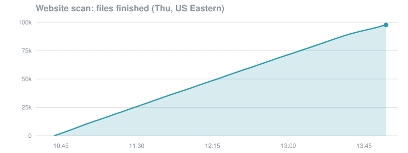
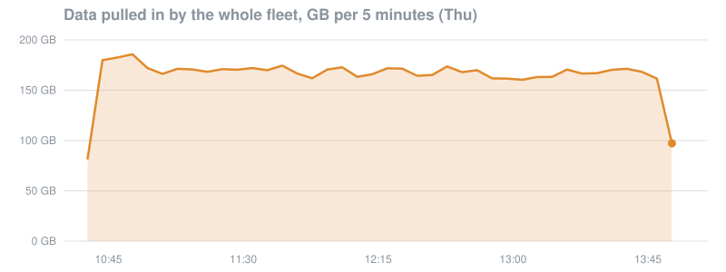
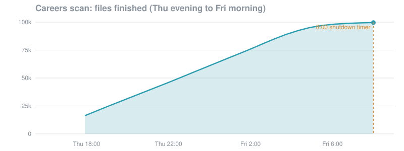

# Reading two billion web pages on a student budget

Two scans of the public [Common Crawl](https://commoncrawl.org/) web archive (crawl `CC-MAIN-2026-43`), run on
up to 24 small AWS machines at once, overnight, on free AWS credits.

- **Scan 1, page text:** read the text of every page to find company homepages and fill in missing company websites.
- **Scan 2, page links:** read every page's links to find careers pages and job boards (Greenhouse, Lever,
  Workday, Ashby and 37 other hiring systems).

The goal was two company lists for two job searches: companies with a careers page in pharma, medical devices,
food and supplements, cosmetics and hospitals; and tech and automotive companies with a careers page.

## At a glance

| | |
|---|---|
| Web pages read | **2.12 billion** |
| Compressed data pulled in | **about 20 TB** |
| Archive files processed | **199,641** |
| Machines at the peak | **24** (2-CPU `c7i-flex.large`, mostly spot) |
| Company-style homepages seen | **13.5 million** |
| AWS cost | **$22.60** of $160 in free credits |
| Errors in machine logs | **0** |

## Timeline (Nov 5–6, 2026, US Eastern)

| When | What happened |
|---|---|
| Thu 10:00 | 1,000-file trial on AWS to measure speed and catch bugs |
| Thu 10:41 | Website scan starts on 24 machines |
| Thu 13:58 | Website scan done: 100,000 files, 2.12 B pages, about 6 TB, in about 3 h 20 min |
| Thu afternoon | First careers pass (10,945 files), then redesigned to also catch careers links in page footers and menus |
| Thu → Fri | Careers scan runs overnight on 22–24 machines across all 100,000 link files, about 14 TB |
| Fri 08:00 | Each machine's shutdown timer ends the run at 99,641 of 100,000 files (99.6%) |
| Fri 09:22 | The free plan's time limit runs out and AWS suspends the account, with $137 of credits unused. All results were already saved |

## The run, in graphs



A near-straight line: about 520 files a minute, held for three hours. The last 2,217 files were finished by a short
clean-up pass.



About 170 GB every 5 minutes (roughly 4.5 Gbit/s) across 23–24 machines, with average CPU near 75%
(Amazon CloudWatch).



Steady at about 128 files a minute overnight, then a long tail: as machines ran out of work, the last slow files
were spread across fewer of them.

## Results

**Tech and automotive companies**
- 53,737 companies with a careers link: 37,270 tech and 16,467 automotive
- 43,519 of them on US-style websites

**Pharma, devices, food, cosmetics and hospitals**
- 144,116 US companies found that weren't on the existing list; 34,735 of them have a careers page
- 1,983 missing websites filled in on the existing list
- 19,072 companies on the existing list now have a careers page

The company lists themselves are not in this repo.

## How it works

- **Many small machines.** The free AWS plan only allows 2-CPU instance types, so the work was split across up to
  24 of them, mostly spot instances. Each reads Common Crawl files directly from its public S3 bucket in the
  same region (`us-east-1`), which is fast and free of transfer charges.
- **Nothing lost on a crash.** Each input file produces its own small `.jsonl.gz` result in S3. Restarted
  machines skip finished files, then sweep the whole list for anything left over.
- **Plain Python.** Standard library plus `boto3`, so a machine is working about a minute after boot.
- **Cleans up after itself.** Instances shut themselves down when done and delete their own disks on shutdown.
  Each pushes its log to S3 every two minutes.
- **Two passes, memory-safe.** Post-processing streams results into Parquet with `pyarrow`, built to fit in 16 GB of RAM.

Sample machine log near the end of the website scan:

```
3475 files   9869s  22.6 MB/s gz  cpu/file 4.0s  fetch/file 1.6s  errs 0
3500 files   9935s  22.6 MB/s gz  cpu/file 4.0s  fetch/file 1.6s  errs 0
3525 files  10000s  22.7 MB/s gz  cpu/file 4.0s  fetch/file 1.6s  errs 0
3550 files  10068s  22.7 MB/s gz  cpu/file 4.0s  fetch/file 1.6s  errs 0
```

## What went wrong, and the fix

- Common Crawl throttles downloads from outside AWS, so even the first small test had to run on AWS.
- The first test machines finished nothing: Python's one-shot `gzip.decompress` slowed to a crawl on these
  multi-part files. Streaming with `gzip.GzipFile` fixed it.
- Company-name matching was too slow and too loose at first. Matching only names that appear in the website's own
  address made it fast and about 95% accurate in spot checks.
- Account limits capped how many machines could start at once. Launch loops wait and retry until slots free up.
- The careers scan's last 1% took about three hours longer than estimated, and a shutdown timer left on each
  machine ended it at 99.6%.

## Files

| File | What it does |
|---|---|
| `scan.py` | The scanner. Page-text files: company-name matches and homepage scoring. Link files: careers links, job-board links, careers subdomains and tech/automotive homepage tags. One result file per input file |
| `aws_run.sh` | Sets up the bucket and instance role, launches the machines (spot or on-demand), shows status, cleans up |
| `post_stream.py` | Streams the page-text results into Parquet and builds the website matches |
| `tech_companies.py` | Builds the tech and automotive company list with careers links from the link-scan results |
| `run_story.py` | Pulls CloudTrail launches, CloudWatch CPU and network metrics, and S3 completion times for the graphs |
| `rules.json` | Industry keywords used to score homepages |

`scan.py` also takes a `patterns.tsv` of company names to look for (`pattern <TAB> full|core <TAB> names`), which
is not included here.

```bash
export CCSCAN_BUCKET=my-ccscan-bucket   # optional; defaults to ccscan-<account id>
./aws_run.sh setup
./aws_run.sh test
./aws_run.sh full
./aws_run.sh status full
./aws_run.sh cleanup
```

Data: Common Crawl, used under its [terms of use](https://commoncrawl.org/terms-of-use).
